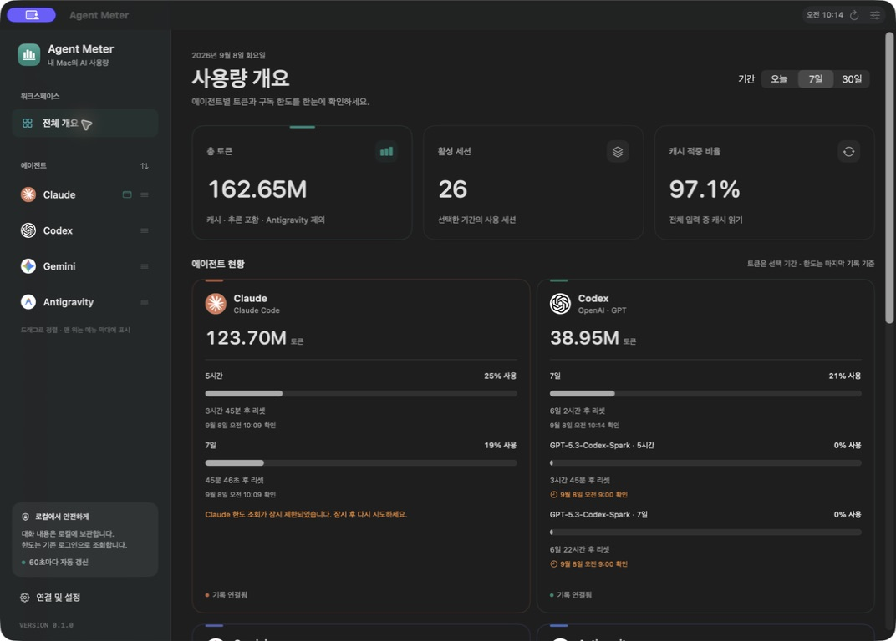
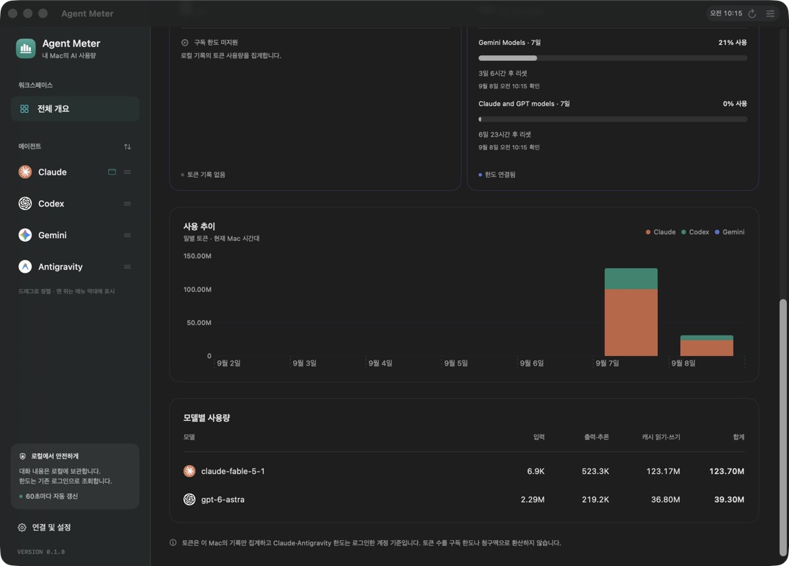

# Agent Meter

Claude Code, Codex, Gemini CLI, Antigravity의 사용량을 모아 보는 **SwiftUI macOS 네이티브 앱**입니다. 토큰은 Claude·Codex·Gemini의 로컬 사용 기록에서 읽고, Claude와 Antigravity 구독 한도는 기존 로그인으로 조회합니다. 별도 API 키는 필요하지 않습니다.

## 화면 예시

실제 앱의 다크 모드 화면입니다. 사용량과 한도는 2026년 9월 8일 캡처 시점의 값입니다.

**전체 개요** — 총 토큰, 활성 세션, 캐시 적중 비율과 에이전트별 구독 한도를 확인합니다.



**사용 추이와 모델별 사용량** — 일별 토큰 차트와 모델별 입력·출력·캐시 사용량을 확인합니다.



## 실행

빌드된 앱: [`dist/Agent Meter.app`](dist/Agent%20Meter.app)

```bash
open "dist/Agent Meter.app"
```

macOS 14 이상. 현재 빌드 머신 아키텍처용으로 생성됩니다. 이 작업 환경에서 만든 앱은 Apple Silicon용이며 로컬 실행을 위한 ad-hoc 서명을 사용합니다. 외부 배포용 Developer ID 서명·공증은 포함하지 않습니다.

## 기능

- 메뉴 막대에 첫 번째 에이전트의 **16pt 원형 로고 + 한도 사용률 + 리셋까지 남은 시간** 표시 (예: 로고 옆 `42% · 2h 15m`). 글꼴은 **SF Mono Medium 13pt**이며 로고·사용률·구분점·시간 항목 간격은 **8pt**로 통일. 에이전트 이름은 툴팁에서 확인
- 대시보드 왼쪽 **에이전트 행을 드래그**해 원하는 위치의 행에 놓으면 전체 순서 변경. 변경한 순서는 대시보드·요약 패널에 함께 반영되고 재실행 후에도 유지되며, 맨 위 에이전트가 메뉴 막대에 표시됨
- 드래그할 위치에 강조 테두리 표시. 우클릭의 **위로 이동 / 아래로 이동**과 접근성 동작으로도 정렬 가능. 목록 밖에 놓으면 순서를 변경하지 않음
- 연결 및 설정 → 일반 → **대시보드 1번 에이전트**에서도 변경 가능. 나머지 에이전트의 상대 순서는 유지하며 기존 첫 번째 에이전트 설정도 보존
- 메뉴 막대는 5시간 한도 우선, 없으면 주간 등 수집된 한도를 표시. 사용률 뒤에 별표를 붙이지 않으며 기록 확인 시각은 툴팁에서 확인. `갱신 대기`는 리셋 시각 경과를 의미하며 한도 정보가 없으면 `—`로 표시
- 메뉴 막대를 클릭하면 360pt 요약 패널: 오늘의 총 토큰·활성 세션, 에이전트별 비중과 사용량, 마지막 구독 한도·리셋 시각
- 요약 패널에서 새로고침, 연결 설정, 대시보드 열기·종료
- 전체 / Claude / Codex / Gemini / Antigravity 필터
- Antigravity 실행 시 자동 연결: 모델 그룹별 한도 사용률·리셋 시각, 90% 알림. 토큰·세션 집계는 미지원
- 오늘 / 최근 7일 / 최근 30일 토큰 추이
- 모델별 입력·출력·캐시 토큰과 활성 세션 수
- 60초 자동 갱신, 수동 갱신 `⌘R`
- Claude·Codex·Antigravity의 한도 사용률 90% 도달 시 macOS 알림, 한도 기간별 중복 방지
- 기록 폴더 변경, 수집 오류와 데이터 없는 상태 안내
- 작은 로고, 통일된 카드·여백·청록색 강조를 적용한 대시보드와 요약 패널. 시스템 라이트·다크 모드 지원

## 연결 범위

| 에이전트 | 기본 데이터 경로 | 토큰 | 구독 한도 |
| --- | --- | --- | --- |
| Claude Code | `~/.claude/projects/**/*.jsonl` | 자동 수집 | 기존 Claude Code 로그인으로 직접 조회; statusLine 기록은 대체 경로 |
| Codex | `~/.codex/{sessions,archived_sessions}/**/*.jsonl` | 자동 수집 | 로그에 기록된 마지막 사용률·리셋 시각 |
| Gemini CLI | `~/.gemini/tmp/**/chats/session-*.{json,jsonl}` | 토큰 필드가 있는 세션에서 수집 | v0.1 미지원 |
| Antigravity | 실행 중인 앱의 로컬 서버 자동 탐색 | 미지원 | 모델 그룹별 사용률·리셋 시각 직접 조회 |

Codex 폴더를 변경할 때는 `sessions`의 **상위 폴더**를 선택하세요. 실행 환경에 `CODEX_HOME` 또는 `CLAUDE_CONFIG_DIR`가 전달되어 있으면 이를 기본값으로 사용합니다. Finder로 실행한 앱에는 셸 환경 변수가 전달되지 않을 수 있으므로 연결 설정에서 경로를 바꿀 수 있습니다.

토큰 집계에는 웹 채팅, 다른 Mac, 원격 서버, 별도 API 프로젝트 사용량을 포함하지 않습니다. Claude·Antigravity 구독 한도는 로그인한 계정 기준입니다. 기록이 삭제되면 집계에서도 제외됩니다. 따라서 이것은 **로컬 기록 기반 사용 현황**이며 계정 전체의 청구 명세가 아닙니다.

### Claude 구독 한도 연결

앱 실행, 60초 자동 갱신, 수동 새로고침 때 Claude Code가 사용하는 `https://api.anthropic.com/api/oauth/usage`를 조회합니다. macOS 키체인의 기존 `Claude Code-credentials` 로그인에서 액세스 토큰을 메모리로 읽어 Claude 서버에만 전송하며, 디스크에 저장하거나 리디렉션을 따라가지 않습니다. 키체인 권한 요청이나 로그인 변경은 자동으로 하지 않습니다. 조회 실패 시 이유를 표시하고 마지막 기록의 실제 확인 시각을 유지합니다. 이 방식은 Claude Code의 내부 한도 조회 경로이므로 제공사 변경에 영향을 받을 수 있습니다.

아래 statusLine 연결은 직접 조회가 불가능할 때 사용할 수 있는 대체 수집 경로입니다.

1. 앱을 계속 사용할 위치에 둡니다. 연결 명령에는 앱 수집기의 절대 경로가 저장됩니다.
2. 앱의 **연결 및 설정 → Claude 한도 연결**을 누릅니다.
3. Claude Code를 다시 시작하고 응답을 한 번 받습니다.
4. 앱에서 새로고침하면 지원되는 5시간·주간 한도가 표시됩니다.

Claude Code **2.1.251 이상**, 한도 필드를 제공하는 구독/게이트웨이가 필요합니다. 이 Mac의 확인된 버전은 2.1.259입니다. 상태 표시줄 데이터에 한도가 없으면 값을 추정하지 않습니다.

연결 시 `projects` 상위 폴더의 `settings.json`에 `statusLine` 명령을 등록합니다. 원본은 같은 폴더에 `settings.agentmeter-backup-<UUID>.json`으로 보관합니다. 기존 `statusLine`이 있으면 자동 연결은 파일을 변경하지 않고 중단합니다.

기존 상태 표시줄을 사용한다면 기존 명령이 받는 JSON을 아래 수집기의 표준입력에도 전달하고 수집기 표준출력은 버리도록 수동으로 연결하세요. 기존 상태 표시줄의 표준출력은 그대로 유지해야 합니다.

```text
Agent Meter.app/Contents/Resources/AgentMeterCapture
```

수집기는 `--output` 옵션으로 저장 위치를 지정할 수 있습니다. 기본 위치는 `~/Library/Application Support/AgentMeter/claude-quota.json`입니다. 한도 사용률·리셋 시각·수집 시각만 저장합니다. 대화, 프로젝트 경로, 인증 정보는 저장하지 않습니다.

연결 해제는 Claude 설정에서 AgentMeterCapture를 호출하는 `statusLine` 항목을 제거하면 됩니다. 백업 전체 복원은 이후 변경한 다른 설정도 되돌리므로 필요한 항목만 복원하세요. 앱을 옮기면 `statusLine.command`의 수집기 경로도 업데이트해야 합니다.

### Antigravity 연결

Antigravity 앱을 실행하고 로그인한 뒤 Agent Meter에서 새로고침하세요. 별도 API 키나 기록 폴더 설정은 필요하지 않습니다. 이 Mac의 **Antigravity 2.12.2**에서 실제 조회를 확인했습니다.

- `RetrieveUserQuotaSummary`로 받은 **모델 그룹별 한도**를 우선 표시합니다. 현재 응답은 Gemini 모델군과 Claude·GPT 모델군의 공유 주간 한도입니다. 남은 비율을 `100 × (1 − remainingFraction)`으로 변환해 **사용한 비율**로 표시합니다.
- 해당 메서드를 지원하지 않는 이전 버전은 `GetUserStatus`, `GetCommandModelConfigs`의 모델별 한도를 사용합니다. 현재 그룹 한도와 이전 모델 한도를 합산하지 않습니다.
- Antigravity를 맨 위로 옮기면 **사용률이 가장 높은 그룹**의 비율과 리셋까지 남은 시간을 메뉴 막대에 표시합니다. 툴팁에서 그룹명을 확인할 수 있습니다.
- 자동 갱신이 켜져 있으면 60초마다 조회합니다. 앱 종료·조회 실패 시 마지막 한도와 실제 확인 시각을 유지하고 오류를 표시합니다. 15분 경과 또는 리셋 시각 경과 시 이전 기록으로 표시합니다. 캐시는 메모리에만 보관되어 Agent Meter 종료 시 사라집니다.
- **토큰·세션·캐시 집계는 미지원**이며 전체 토큰 합계와 차트에서 제외합니다. 한도 비율을 토큰으로 환산하지 않습니다.

현재 사용자 소유의 Antigravity 앱 프로세스에서 로컬 연결 정보를 읽고, 해당 프로세스가 연 `127.0.0.1` HTTP 서버에만 조회합니다. CSRF 토큰과 계정 원본 응답은 저장·로그 출력하지 않으며 리디렉션과 프록시를 사용하지 않습니다. 대화 파일·인증 DB는 읽지 않습니다. 앱 자체가 Google에서 한도를 갱신할 수 있습니다. 이 연동은 Antigravity의 내부 인터페이스이므로 제공사 변경에 따라 업데이트가 필요할 수 있습니다. HTTPS 전용 서버와 별도 `agy` CLI 프로세스는 현재 자동 탐색 대상이 아닙니다.

### 구독 한도를 읽는 방법

표시된 퍼센트는 **사용한 비율**입니다. 한도 윈도우의 길이를 그대로 표시하므로 Codex의 기본 한도가 항상 5시간인 것으로 가정하지 않습니다.

앱 새로고침은 로컬 토큰 기록을 다시 읽고 Claude·Antigravity 한도를 조회합니다. 각 한도에 별도의 **확인 시각**을 표시하며, 15분 이상 지났거나 리셋 시각이 지나면 이전 기록으로 표시합니다. Codex 및 Claude statusLine 대체 기록은 에이전트가 새 기록을 생성해야 값이 바뀝니다. 캐시를 다시 읽었다는 이유로 확인 시각을 현재로 바꾸지 않으며, 토큰 합계로 구독 한도를 추정하지 않습니다.

### 사용량 90% 알림

앱 실행 후 macOS 알림 권한을 허용하면, Claude·Codex·Antigravity의 각 한도(예: 5시간·주간)가 **90% 이상**인 최신 기록을 처음 확인할 때 배너와 소리로 알립니다. 알림에는 에이전트, 한도 이름, 사용률, 확인 가능한 리셋 시각이 표시됩니다. **연결 및 설정 → 사용량 알림**에서 끄거나 권한 상태를 확인할 수 있습니다. 권한을 거부했다면 **시스템 설정 → 알림 → Agent Meter**에서 허용하세요. 배너·소리 표시 여부는 macOS 알림 설정과 집중 모드의 영향을 받습니다.

- 앱이 실행 중일 때 60초 자동 갱신 또는 수동 새로고침으로 검사합니다. 자동 갱신을 끄면 수동 갱신 때만 새 기록을 읽습니다. 실행 시 이미 90% 이상인 최신 기록도 알립니다.
- 같은 에이전트·한도 기간에는 한 번만 전송합니다. 알림 이력은 로컬 앱 설정에 저장되어 재시작 후에도 유지되고, 리셋 후 새 기록에서 다시 90%에 도달하면 알립니다.
- 리셋 시각이 없는 한도는 더 새로운 기록에서 90% 미만을 확인한 뒤 다시 90% 이상이 되었을 때 재알림합니다.
- 15분이 넘은 기록, 리셋 시각이 지난 기록, 미래 시각·잘못된 사용률은 제외합니다. 알림 전송에 실패하면 다음 갱신 때 재시도합니다.
- Claude는 계정 조회 또는 위의 statusLine 연결에서 확인한 한도로 판정합니다. **Gemini는 현재 구독 한도를 수집하지 않아 90% 알림을 지원하지 않습니다.** 토큰 합계로 비율을 추정하지 않습니다.

## 집계 방식

- **Claude:** 메시지 ID + 요청 ID로 중복 제거. 스트리밍 중간 기록 대신 가장 큰 사용량 스냅샷을 유지합니다. 입력, 출력, 캐시 읽기, 캐시 쓰기를 합산합니다.
- **Codex:** `total_token_usage`의 연속 스냅샷 차이를 사용합니다. 캐시 입력은 입력의 부분집합, 추론 출력은 출력의 부분집합이므로 중복으로 더하지 않습니다. 누적 카운터가 재시작되면 새 구간으로 집계합니다.
- **Gemini:** JSON과 JSONL 메시지, `$set.messages` 체크포인트를 지원합니다. 메시지 ID로 중복 제거하며 캐시 입력을 중복 합산하지 않습니다. 생각·도구 토큰은 별도로 더합니다. 되감기로 컨텍스트에서 제거된 응답도 파일에 남아 있으면 사용한 토큰으로 유지합니다.
- **공통:** 0 토큰 응답을 제외하고 불완전한 JSONL 줄은 건너뜁니다. 오류 건수는 설정에 표시합니다. 날짜는 Mac의 현재 시간대 기준이며 오늘은 현재 시각까지입니다.

제공사의 로컬 기록 형식은 공개된 안정 API가 아니므로 형식 변경 시 파서 업데이트가 필요할 수 있습니다. 잘린 세션의 최초 누적 카운터는 해당 기록 시각에 귀속되므로 원래 사용 날짜와 다를 수 있습니다.

JSON 디코딩 중 원본 파일이 메모리에 일시적으로 올라옵니다. 캐시에는 숫자 사용량·모델·시각·세션 식별자만 남고 앱을 종료하면 사라집니다. 토큰 집계는 위 경로의 세션 기록만 읽습니다. Claude 한도 조회에는 키체인의 기존 로그인과 Claude 서버 요청을 사용합니다. Antigravity 한도 조회에는 실행 중인 앱의 로컬 서버만 사용합니다. 대화 내용이나 프로젝트 경로는 전송하지 않습니다.

## 개발

Xcode의 Swift 6 툴체인이 필요합니다. 외부 패키지 의존성은 없습니다.

```bash
swift test
./scripts/build-app.sh
open "dist/Agent Meter.app"
```

`Package.swift`를 Xcode에서 열어 실행할 수도 있습니다. Claude 수집기 연결은 `scripts/build-app.sh`로 패키징한 `.app`에서 사용하세요.

| 파일 | 역할 |
| --- | --- |
| `Sources/AgentMeterCore/Parsers.swift` | 제공사별 토큰·한도 파싱 |
| `Sources/AgentMeterCore/UsageScanner.swift` | 백그라운드 파일 탐색, 캐싱, 중복 제거 |
| `Sources/AgentMeterCore/Aggregation.swift` | 기간·일별 집계 |
| `Sources/AgentMeterCore/AntigravityQuotaClient.swift` | Antigravity 그룹·모델 한도 조회 및 검증 |
| `Sources/AgentMeterCore/AntigravityDiscovery.swift` | 실행 중인 Antigravity와 로컬 포트 탐색 |
| `Sources/AgentMeterCore/AntigravityQuotaMonitor.swift` | 한도 새로고침, 실패 시 마지막 관측 보존 |
| `Sources/AgentMeterCore/ClaudeQuotaClient.swift` | Claude 계정 한도 조회, 응답 검증, 오류 처리 |
| `Sources/AgentMeter/ClaudeCredentials.swift` | 기존 Claude Code 키체인 로그인 읽기 |
| `Sources/AgentMeterCore/ClaudeBridge.swift` | 한도 메타데이터 저장, 설정 백업·연결 |
| `Sources/AgentMeterCore/QuotaAlerts.swift` | 90% 한도 판정, 중복 방지 이력, 실패 재시도 |
| `Sources/AgentMeter/UsageNotifications.swift` | macOS 알림 권한, 배너·소리 전송 |
| `Sources/AgentMeter/` | SwiftUI 앱, 메뉴 막대, 대시보드, 설정 |
| `Sources/AgentMeterCapture/` | Claude statusLine 표준입력 수집기 |
| `Tests/AgentMeterCoreTests/` | 합성 기록·임시 폴더 기반 회귀 테스트 |

## 참고한 공식 문서

- [Antigravity Model Quotas](https://antigravity.google/docs/cli/commands/usage): 모델별 한도 확인 기능. 앱 연동 응답은 설치된 2.12.2 로컬 서버에서 검증

- [Apple UserNotifications](https://developer.apple.com/documentation/usernotifications/unusernotificationcenterdelegate): 앱 전경 알림 표시와 알림 이벤트 처리
- [Claude Code statusLine](https://code.claude.com/docs/en/statusline): 한도 사용률·리셋 필드와 지원 조건
- [Gemini CLI session management](https://geminicli.com/docs/cli/session-management/): 로컬 세션 저장 위치와 토큰 기록
- [Gemini CLI chatRecordingService](https://github.com/google-gemini/gemini-cli/blob/main/packages/core/src/services/chatRecordingService.ts): JSONL 기록 형식
- [OpenAI Codex App Server](https://learn.chatgpt.com/docs/app-server): 향후 실시간 한도 조회용 공식 인터페이스. v0.1은 이 API를 호출하지 않고 실제 로컬 로그를 읽습니다.
